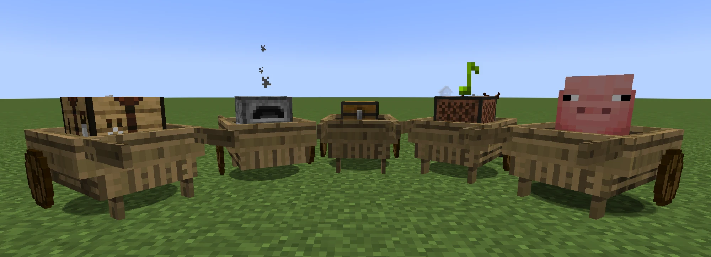

<!--
The text of the mod's page on CurseForge, kept here so it lives under git rather
than only on the site.

The CurseForge API cannot write it: its token covers uploading files and editing
a file's own metadata, nothing about the project itself. So this file is the
source of truth and the page is updated by pasting it in, under
Manage Project -> Description.

The project's other fields, which are also web-only:

  Name     Pull Cart + Loom Ported
  Summary  A wooden cart you pull behind you to carry more. A port of the MC+ mods
           from 1.7.10, originally built by andykuo1
  License  GNU General Public License version 2 (GPLv2)
  Source   https://github.com/TFC-Russia/pull-cart
  Issues   https://github.com/TFC-Russia/pull-cart/issues
-->

# Pull Cart + Loom Ported

A wooden cart you pull behind you by hand. Load a chest, a furnace or a small animal onto it and
walk — no rails, no minecart, no track to lay first.

**This is a port, not my mod.** The cart, the wheel and the loom are **MC+ Cart**, **MC+ Wheel** and
**MC+ Loom** by **andykuo1**, written for Minecraft 1.7.10. The original source is at
[github.com/andykuo1/mcplus-mods](https://github.com/andykuo1/mcplus-mods) under the GPL-2.0, and
this port is GPL-2.0 for that reason. The model geometry and the textures are andykuo1's.

## The cart

| Do | What happens |
|---|---|
| Right-click a surface block with the Wooden Cart | Sets the cart down, facing the way you look |
| Right-click the cart | You pull it — it follows you and climbs one-block steps; again to let go |
| Pull it while riding a horse | The horse pulls it |
| Right-click holding a chest, crafting table, ender chest, furnace or jukebox | Loads that block onto the cart |
| Shift + right-click the cart | Uses the loaded block: a 27-slot chest, a crafting grid, your ender chest, a furnace that keeps smelting while you travel, or a jukebox |
| Right-click while leading a small animal | Puts the animal in — anything taller than 1.5 blocks does not fit, and the cart has to be empty |
| Hit it a few times | Breaks it the way a minecart or a boat breaks: the cart, the block on it and everything that block held drop on the ground |
| Shift + hit it | Takes the loaded block off — the block itself drops empty and what it held falls out beside it |

The cart lets go when it falls more than 6 blocks behind, and it breaks under water — both as the
original did. While a jukebox on it is playing, it stays put.

Any chest or crafting table works, TerraFirmaCraft's wooden ones included. Other mods can reach a chest
on a cart that nobody is pulling, the way they reach a chest block.

## Crafting

- **Wooden Wheel** — 8 sticks around a slime ball (TFC glue works too)
- **Wooden Cart** — planks in a U, two wheels underneath
- **Wooden Loom** — planks and a wheel

## The loom

MC+ Loom's loom spins wool into string. It works like a furnace with two fuel slots: wool on top, a
spindle in each of the two slots below.

- A block of wool, any colour, becomes 4 string in 20 seconds.
- Spindles: a stick (10 s), a blaze rod (40 s) or shears (160 s). Both slots need one, and the loom
  runs for as long as the pair lasts together.
- The wheel turns and smoke puffs while it spins. Taking the string out gives the experience it
  earned, as a furnace does.
- Hoppers feed it from the top and the sides and pull string from the bottom. A comparator reads it.

What it spins and what it accepts as a spindle are **recipes**, so a datapack, KubeJS or CraftTweaker
can add, change or remove them. The recipe types are `pull_cart:spinning` and `pull_cart:spindle`;
the [README](https://github.com/TFC-Russia/pull-cart#loom-recipes-datapacks) has the JSON.

## With TerraFirmaCraft

TerraFirmaCraft is **not required** — the mod runs on its own. When TFC is present:

- The cart is a huge, very heavy item like an anvil: no TFC chest, vessel, barrel or bundle takes it,
  carrying one exhausts you and two overburden you.
- The loom spins TFC wool into 8 wool yarn and takes TFC spindles, twigs and metal shears. A TFC
  spindle turns it for 20 seconds and loses 1 durability, so a pair spins 80 wool before breaking.
- A chest on the cart holding more than 4 huge, very heavy items is too heavy to pull. The limit is
  `tfc.maxHeavyItems` in `config/pull_cart-common.toml`.

## What changed from the original

- Forge 1.20.1 and NeoForge 1.21.1 instead of Forge 1.7.10, rewritten against the current API.
- The loom's recipes became datapack recipes. In the original they were hard-coded.
- TerraFirmaCraft integration: item sizes and weights, TFC wool and spindles, the weight limit.
- The cart now breaks the way a minecart or a boat does, instead of being destroyed by a single hit.
- `config/pull_cart-common.toml`: the distance the cart follows at, the distance it lets go at, and
  the weight limit.
- MC+ Cart's own dependency on the MC+ API is gone; this needs nothing but the loader.

## Credits

- **andykuo1** — MC+ Cart, MC+ Wheel and MC+ Loom: the code this port is built on, the models and the
  textures. Copyright (C) 2014–2015. [Original source](https://github.com/andykuo1/mcplus-mods).
- **koenigstag** — the Forge 1.20.1 and NeoForge 1.21.1 ports. Copyright (C) 2026.

GPL-2.0, the licence of the original. Source:
[github.com/TFC-Russia/pull-cart](https://github.com/TFC-Russia/pull-cart).
